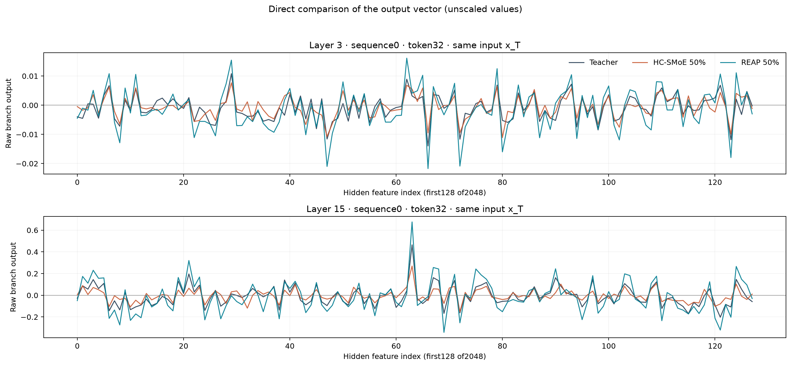
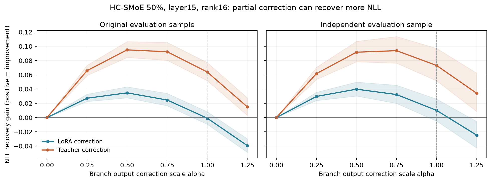

# MoE Compression Analysis

**MoE 압축은 output을 어떻게 바꾸며, 그 차이는 언제 실제 NLL 손실로 이어지는가?**

OLMoE-1B-7B-0924에서 REAP pruning과 HC-SMoE merging을 비교하고, Oracle 복원·Expert LoRA·NLL gradient/interpolation으로 recovery를 진단합니다.

[분석 문서](reports/overview.md) · [결과 CSV](results/README.md) · [인터랙티브 뷰어 HTML](docs/viewer/index.html) · [게시·로컬 실행](DEPLOYMENT.md)

인터랙티브 뷰어는 HTML을 다운로드해 브라우저에서 열거나 저장소를 clone한 뒤 `docs/viewer/index.html`을 열면 바로 동작합니다. GitHub Pages를 `main /docs`로 설정하면 `https://decembix.github.io/MoE-Compression-analysis/`에서 접근할 수 있습니다. GitHub 파일 화면의 HTML은 소스로 표시됩니다.

## 같은 입력에서 본 압축 전후 output

짙은 선은 Teacher, 주황은 HC-SMoE 50%, 청록은 REAP 50%입니다. 같은 Teacher pre-MoE 입력을 넣고 residual addition 전 branch output을 비교했습니다.



*L3/L15, sequence0, token32, features0–127의 실제 값. Layer 예시를 전체 모델의 대표 성능으로 해석하지 않습니다. 앞선 압축 layer에서 누적되는 입력 차이는 이 비교에 포함하지 않았습니다.*

## 현재 확인한 세 가지

1. **Output L2가 큰 layer와 NLL에 민감한 layer는 다릅니다.** 기존 50% 압축 실험에서 두 순위의 상위3개 layer 교집합은 HC와 REAP 모두 0개였습니다. 고정16 layers의 탐색적 결과입니다.
2. **Output error 감소가 NLL 개선을 보장하지 않습니다.** HC L15는 동일 LoRA correction을 절반만 적용했을 때 더 큰 NLL gain을 보였습니다. Teacher correction도 partial restoration이 full restoration보다 좋은 경우가 있었습니다.
3. **일부 순위는 새 표본에서 유지되지 않습니다.** HC L3가 L10보다 좋았던 LoRA gain 순위는 독립 표본에서 유지되지 않았고, 차이 CI는 0을 포함했습니다. REAP L15의 positive gain은 유지됐습니다.



*양수는 NLL 개선. 음영은 32 packed sequences의 paired-bootstrap 탐색적95% CI입니다. α는 parameter scaling이 아닌 MoE branch output scaling입니다. Independent는 같은 C4 validation shard의 새 source-document 표본입니다.*

기존 표본에서 선택한 HC L15 α=0.5를 새 표본에 적용하면 α=1 대비 NLL gain이 **+0.02973**, 95% CI **[+0.02247, +0.03668]** 증가했습니다. 방향 오정렬을 배제한 인과적 결론은 아니며, magnitude와 비선형 response의 영향을 지지하는 관찰입니다.

## 실험 범위

| 항목 | 범위 |
|---|---|
| Teacher | allenai/OLMoE-1B-7B-0924 |
| 압축 방법 | HC-SMoE / REAP, physical experts 기준25%·50% |
| 인터랙티브 raw output 비교 | HC-SMoE / REAP 50%, 동일 Teacher 입력 |
| Pilot recovery | 50% 모델, 선택 layer의 expert-only LoRA rank8·16 |
| 진단 | NLL gradient, branch interpolation, independent evaluation |
| Sub-MoE / SVD | 미실험 |

각 실험의 입력 조건·표본·지표와 한계는 [분석 상세](reports/overview.md)에 기록했습니다. Oracle은 실제 recovery의 수학적 upper bound로 취급하지 않습니다.

## 재현

공개 CSV와 뷰어에 포함된 실제 output subset으로 그림을 재생성합니다. 모델/GPU는 필요 없습니다.

```bash
python -m pip install -r requirements-visualization.txt
python scripts/replot.py --output reproduced
```

이 저장소는 분석 자료와 시각화 재현 범위를 제공합니다. 모델 checkpoint, training/calibration tokens, 전체 activation cache와 대형 token-level CSV는 포함하지 않습니다. 모델 실험 전체를 이 저장소만으로 재현할 수 있다고 주장하지 않습니다. [입력 조건·표본·지표](reports/methodology.md), [원자료 manifest](results/manifest.json), [폰트 고지](THIRD_PARTY_NOTICES.md)를 참고하세요.
