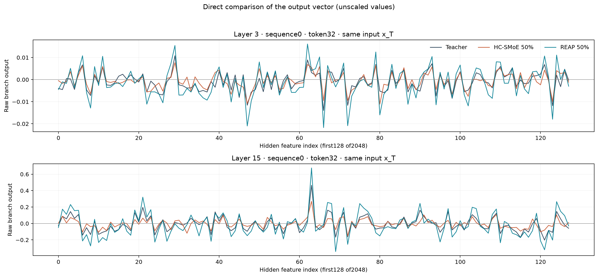
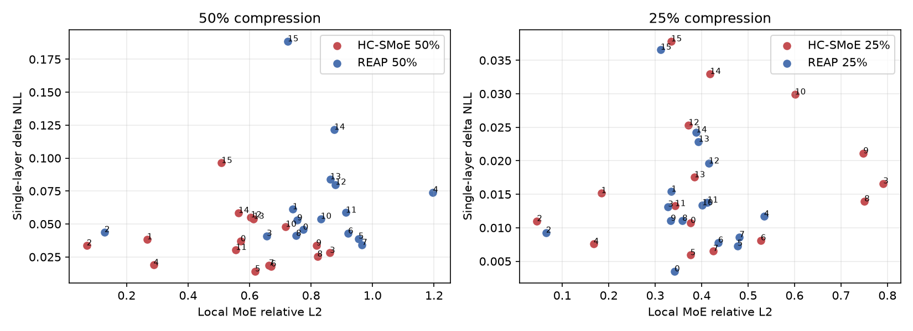

# 압축 후 output 손실

[개요](overview.md) · [CSV](../results/compression/)

같은 Teacher pre-MoE 입력 x_T에서 원래64-expert branch와 compressed branch를 비교했습니다. 기존 HC alias/router 구조를 유지했고 REAP retained experts/router만 사용했습니다. 압축률25%·50%는 physical experts48·32개를 뜻합니다. 인터랙티브 raw output 뷰어는50%만 포함합니다.

## 출력과 성능을 구분

50% HC local L2 상위 layer는3,8,9이나 Teacher에서 한 layer만 압축한 ΔNLL 상위는15,14,12입니다. REAP은 각각4,7,5와15,14,13입니다. n=16 layers의 탐색적 결과이고, 여러 layer 손실을 합산해 전체 압축 모델의 손실로 취급하지 않습니다.

원자료: [layer output](../results/compression/layer_output_error.csv), [single-layer sensitivity](../results/compression/layer_sensitivity.csv), [correlation/CI](../results/compression/correlation_analysis.csv).

## REAP

제거된 expert contribution과 rerouting difference를 분해했습니다. 재선택과 full-softmax 분모 변화에 따른 retained weights 변화가 후자에 포함됩니다. 50%의 평균 relative component norm은 각각0.42237,0.74194였습니다. 두 vector의 cross-term을 포함해야 하며 norm을 단순 합하지 않습니다. 모든16 layers에서 부분 상쇄가 있어도 total error가 removed-only보다 작지는 않았습니다. 이 norm을 NLL 원인의 비율로 해석하지 않습니다.

원자료: [decomposition](../results/compression/error_decomposition.csv), [cancellation](../results/compression/reap_error_cancellation.csv).

## HC-SMoE

원래64 router slots와 weights를 유지하는 alias 구현에서는 routing component가0이고 차이가 merged-expert approximation에 귀속됐습니다. Alias collision의 영향도 이 정의상 expert approximation에 들어갑니다. 다른 compact-router 구현으로 일반화하거나 routing 자체가 중요하지 않다고 해석하지 않습니다.

원자료: [routing summary](../results/compression/routing_summary.csv), [cluster diagnostics](../results/compression/cluster_summary.csv).

## 평가

전체 모델의 WikiText PPL과5개 zero-shot benchmark 결과는 [evaluation.csv](../results/compression/evaluation.csv)에 있습니다. Block 자체의 PPL/ACC가 아니라 block 개입 후 전체 모델 NLL을 측정했습니다. Block별 benchmark ACC intervention은 미실험입니다.
