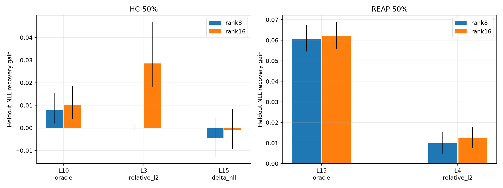

# Expert-only LoRA output recovery

[개요](overview.md) · [원자료](../results/recovery/lora_recovery.csv)

50% compressed 모델의 선택 layer에서32 physical experts의 gate/up/down projections만 LoRA로 학습했습니다. Base/router/attention/norm/head와 HC alias는 frozen입니다. REAP에서 deleted experts를 다시 추가하지 않았습니다. Target은 실제 compressed pre-MoE 입력 x_C의 Teacher output f_T(x_C)이며 output MSE만 사용했습니다.

32×1024 unique training tokens,256 steps×512 tokens=131072 token presentations,4 epochs,AdamW lr1e-3,seed42를 모든 case에 동일하게 적용했습니다. Rank8/16의 trainable count는 각각2359296/4718592입니다. 아래는 원래 layer-selection validation32×1024의 결과로 독립 test가 아닙니다.

| Method / layer / rank | L2 before → after | NLL gain [95% CI] |
|---|---|---|
| hc L10 r8 | 0.7727 → 0.5549 | +0.007798 [+0.001947, +0.015489] |
| hc L10 r16 | 0.7727 → 0.5534 | +0.010096 [+0.003826, +0.018530] |
| hc L3 r8 | 0.9028 → 0.9025 | +0.000081 [-0.001010, +0.001168] |
| hc L3 r16 | 0.9028 → 0.7449 | +0.028470 [+0.018047, +0.046945] |
| hc L15 r8 | 0.4460 → 0.2043 | -0.004544 [-0.012802, +0.004217] |
| hc L15 r16 | 0.4460 → 0.2007 | -0.000870 [-0.009362, +0.008239] |
| reap L15 r8 | 0.7568 → 0.3093 | +0.060753 [+0.054570, +0.067196] |
| reap L15 r16 | 0.7568 → 0.3046 | +0.062133 [+0.055764, +0.068806] |
| reap L4 r8 | 1.2661 → 0.3605 | +0.009825 [+0.004709, +0.015108] |
| reap L4 r16 | 1.2661 → 0.3566 | +0.012687 [+0.007705, +0.017775] |

모든 case에서 L2가 감소했지만 NLL 회복은 일관되지 않았습니다. HC L15의 음수 gain 점추정 CI는0을 포함했습니다. HC layer-selection 순위는 rank에 따라 달랐고, 이후 independent evaluation에서 L3가 L10보다 우수한 순위가 유지되지 않았습니다. [후속 진단](recovery-diagnosis.md)을 함께 보세요.

원자료: [layer comparison](../results/recovery/layer_selection_comparison.csv), [Oracle vs LoRA](../results/recovery/oracle_vs_lora.csv), [residual](../results/recovery/residual_analysis.csv).

Oracle A는 reference이며 실제 parameter-efficient recovery의 수학적 upper bound가 아닙니다. 체크포인트와 전체 training 코드/데이터는 이 공개 저장소의 배포 범위에 포함하지 않습니다.
