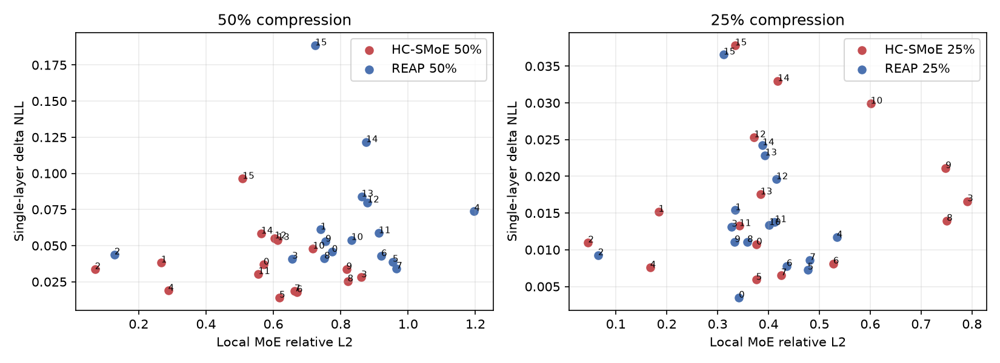
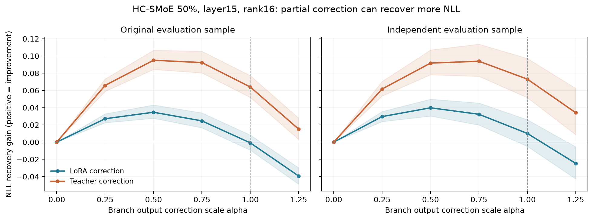

# 분석을 읽는 순서

[요약으로 돌아가기](../README.md) · [뷰어](../docs/viewer/index.html) · [CSV](../results/README.md)

## 1. 압축 방법별 output 차이는 어디서 발생하는가?

REAP에서는 제거한 expert의 기여 손실과 retained expert 재선택/softmax weight 변화가 함께 발생했습니다. 기존50% 압축에서 평균 relative component norm은 removed contribution0.422, rerouting difference0.742였습니다. Norm은 가산하지 않으며 cross-term을 포함해야 합니다. 두 성분의 부분 상쇄가 있어도 total error가 removed-only보다 작아지는 것은 아닙니다. 이 component 크기를 그대로 NLL 원인 비율로 해석하지 않습니다.

HC-SMoE의 기존 구현은 원래64 router slots와 weights를 유지하고32 physical merged experts로 매핑했습니다. 이 분해 정의에서는 routing component가0이고, 차이가 expert approximation 항에 귀속됐습니다. Alias collision이 무해하거나 다른 HC 구현에서도 routing error가0이라는 뜻은 아닙니다.

**측정 조건:** 이 비교는 동일 Teacher pre-MoE 입력 x_T에서 실행한 local branch 차이입니다. Full compressed trajectory의 실제 입력 x_C와 구분합니다.

## 2. Output error가 큰 layer가 성능을 가장 많이 손상시키는가?

| 50% 압축 | HC-SMoE | REAP |
|---|---|---|
| Local Relative L2 상위3 layer | 3,8,9 | 4,7,5 |
| Teacher에서 한 layer만 압축한 ΔNLL 상위3 | 15,14,12 | 15,14,13 |
| Full compressed model에서 Local Oracle A gain 상위3 | 10,2,3 | 15,2,3 |

Layer 번호는0부터 시작합니다. 서로 다른 문맥의 개입을 구분해야 하며 single-layer 손실이나 복원 gain을 합산해서 전체 손실로 해석하면 안 됩니다. NLL/PPL은 해당 layer 자체의 점수가 아니라 개입 후 **전체 모델**의 평가입니다. Block별 benchmark ACC 개입은 아직 측정하지 않았습니다.

## 3. Output recovery는 실제 NLL을 개선하는가?

Expert-only LoRA output distillation은 일부 case에서 held-out NLL을 개선했습니다. 모든 pilot case의 output L2가 감소했지만 HC L15 등의 NLL 변화는 이에 일치하지 않았습니다. Rank/layer selection 순위도 고정된 한 표본에서의 관찰과 독립 표본에서의 검증을 나눠 봐야 합니다.

Local Oracle A의 teacher target은 compressed model의 실제 입력 x_C에서 계산한 f_T(x_C)입니다. 시각화의 공통 Teacher 입력 x_T와 다릅니다. 데이터가 다르거나 target 입력 조건이 다른 L2 값을 같은 종류의 비교로 섞지 않습니다.

## 4. 방향 문제와 크기 문제를 어떻게 구분했는가?

HC L15의 global NLL gradient와 LoRA correction의 dot은 음수였으므로 baseline에서의1차 predicted gain은 양수였습니다. 같은 correction을 α=.5로 적용하면 기존 표본 gain+.03470, 독립 표본 gain+.03984였습니다. α1은 각각−.00087, +.01011이며 두 α1의 CI 모두0을 포함했습니다.

Original-selected α=.5를 independent에 이전한 α1 대비 개선은+.02973, CI[+.02247,+.03668]였습니다. 같은 direction도 magnitude에 따라 성능이 바뀐다는 직접 관찰입니다. H1을 배제하거나 H2만이 원인이라고 확정하지 않습니다. Token별로 유리/불리한 component가 공존했습니다.

L15는 마지막 decoder layer이므로 이 case의 suffix에는 후속 MoE/router가 없습니다. Final norm/head/CE의 비선형 response와 correction 성분·크기를 고려해야 합니다. Teacher correction도 부분 복원에서 더 나은 NLL을 보였으므로 exact teacher output MSE=0이 task loss 최적점을 보장하지 않습니다.

## 다음 연구

Magnitude-calibrated 기존 MSE 모델을 baseline으로 두고 NLL-aware output distillation을 우선 비교하는 것이 타당합니다. Alias-specific LoRA의 추가 이득은 아직 검증하지 않았으며, alias 변경이 필수 원인이라는 증거도 없습니다. 다음 training은 이번 게시/시각화 작업에서 실행하지 않습니다.

## 해석의 한계

- Main/independent 각32 packed sequences, C4 validation 같은 shard. 새로운 domain 검증이 아닙니다.
- Independent는 기존 source documents를 제외했지만 packed sequences가 같은 문서를 공유할 수 있어 CI는 탐색적입니다.
- Original sample은 layer-selection에 활용됐습니다. Independent alpha grid의 최대값을 새 tuned model의 독립 성능으로 주장하지 않습니다.
- Teacher-input local error, compressed-input local recovery, full-model NLL을 구분합니다.
- BF16 gradient와 piecewise routing derivative는 finite intervention의 NLL을 정확히 예측하는 보장이 없습니다.
- Sub-MoE/SVD와 block별 ACC intervention은 미실험입니다.

원자료: [압축 및 Oracle](../results/compression/) · [LoRA recovery](../results/recovery/) · [진단 및 independent evaluation](../results/diagnosis/) · [방법](methodology.md).
